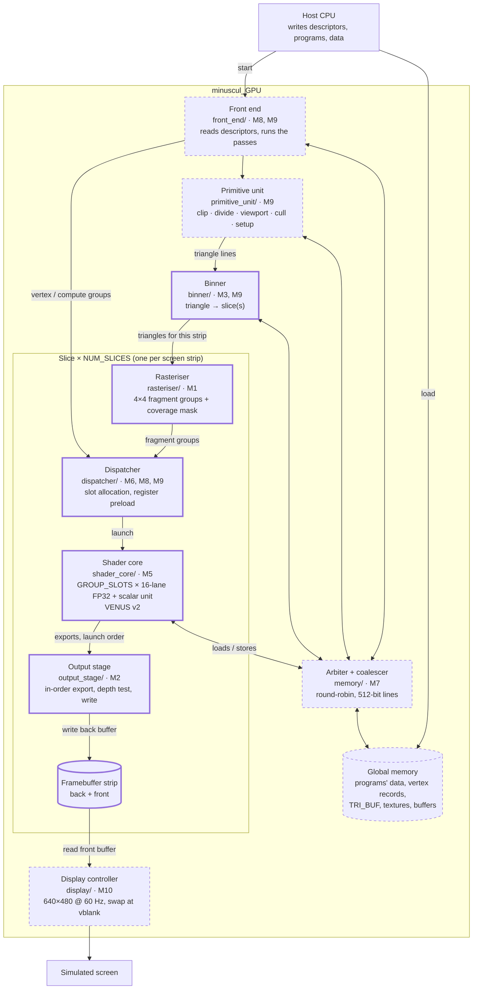
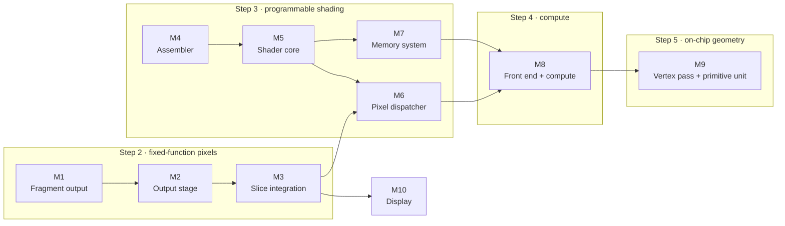

# minuscul_gpu
This is a small gpu implementation made using py4hw.

The working part today is a hardware **triangle rasteriser**: it takes
triangles that are already in screen space (pixel X/Y plus a depth Z) and
fills a framebuffer with their colour, with a depth test. It runs as a
cycle-accurate py4hw simulation and can be scaled from one core to many.
There is no vertex stage (3D → screen transform) or programmable shader
core wired in yet.

**Continuing the work?** Start with [CLAUDE.md](CLAUDE.md): current state,
how to work on the project, pitfalls, and the detailed next step.

## Repository layout

```
minuscul_GPU/
├── src/                     one folder per hardware block (see src/README.md for modules M1-M10)
│   ├── rasteriser/          rasteriser (renderer.py: RenderModule, MultiCoreRenderModule, Binner, math blocks)
│   ├── memory/              MemoryInterface, Memory; later global memory, arbiter, coalescer
│   ├── binner/  output_stage/  slice/  shader_core/  dispatcher/
│   ├── front_end/  primitive_unit/  display/      planned blocks, each with a README
│   ├── legacy/              superseded code (Theadv1.py: VENUS v1 thread)
│   ├── README_ISA.md        VENUS v2 ISA specification (README_ISA_v1.md: old draft)
│   ├── Architecture..md     chosen architecture and final decisions
│   └── decisions.md         decision log (options, trade-offs, reasons)
├── tools/                   venus_asm assembler (planned, M4)
├── tb/rasterisationTest/    pytest suite, benchmark and animations
└── algorithms/
    ├── rasterisation.py     software reference renderer (numpy/PIL, full 3D pipeline)
    └── inGpuAlgoithms.md    list of GPU algorithms with status in this repo
```

## Component status

| Component | Status |
|---|---|
| `Slice` / `SliceArray`: rasteriser → flat-colour unit → output stage, 1-N slices with binner (M1-M3, build step 2) | **Working**, covered by tests; canonical scene 21,944 cycles on 1 slice, 3,864 on 8 |
| Banked framebuffer writes (`write_bank_count`) | Working, covered by tests |
| VENUS v2 assembler (`tools/venus_asm.py`, M4), shader core (`src/shader_core/`, M5) and pixel dispatcher (`src/dispatcher/`, M6) | **Working**, covered by tests: slices run VENUS v2 pixel shaders (`Slice(..., shading='shader')`), e.g. Gouraud shading. Build step 3 done; global memory is still a private copy per slice until M7 |
| Legacy `RenderModule` / `MultiCoreRenderModule` | Kept as the golden reference for tests and for the two animations |
| `MatrixMultiplier4x4`, `CrossProduct`, `Vector3Norm` | Built as standalone blocks, not connected to the rasteriser |
| `legacy/Theadv1.py` (VENUS v1) | Superseded: implements the old v1 draft ([README_ISA_v1.md](minuscul_GPU/src/README_ISA_v1.md)) and doesn't build (wrong `py4hw.Logic` arguments, `self.mem` never set, no instruction fetch). Replaced by the VENUS v2 shader core (`src/shader_core/`, spec [README_ISA.md](minuscul_GPU/src/README_ISA.md)) |
| `display/screen.py` | Doesn't import inside the package (`from memory import *`). It uses a `resp` signal that `MemoryInterface` doesn't have, and it blocks in `mainloop()` inside `__init__` |
| `registerFile` in `memory.py` | Stub: it uses a local `reg` list, so `clock()` fails |

## Target architecture

The architecture of the full chip has been decided (graphics GPU with
programmable 16-lane FP32 shader cores, one slice per screen strip, VENUS v2
ISA, on-chip display controller). The summary and the final decisions are in
[Architecture..md](minuscul_GPU/src/Architecture..md); the reasoning behind
each one is in [decisions.md](minuscul_GPU/src/decisions.md). The
implementation is split into work modules M1-M10, listed with their
dependencies in [src/README.md](minuscul_GPU/src/README.md).

### Chip block diagram

Each block shows its source folder and the work module that builds it.
Thick border = code exists today; dashed border = planned.



A frame runs in two passes:
1. **Geometry:** vertex shaders run on the slices' shader cores, then the
   primitive unit turns their output into screen-space triangles.
2. **Pixels:** the binner sends each triangle to the slices it covers.
   Each slice rasterises, shades and writes its own strip of the screen.

Compute kernels use the same cores, launched by the front end without the
rasteriser.

### Build plan



M4 (assembler) needs nothing else and can be built at any time. M10
(display) can be built at any time after M3. Each module's tasks and "done
when" test are in its folder's README.

## How the pixel path works today (build step 2)

1. **Binner:** sends each triangle (one 512-bit line: 3 vertices + colour) to the slice(s) whose strip of rows it touches.
2. **Rasteriser** (per slice): clamps the bounding box and picks a coarse tile size (4, 8 or 16) from it. Coarse tiles are corner-tested with edge functions and rejected or split. Each 4×4 tile is tested in one round on 16 parallel lanes, and every covered tile is emitted as a **fragment group** (coverage mask, depth per pixel).
3. **Flat-colour unit:** gives every covered pixel the triangle's colour. It stands in for the programmable shader core (M5/M6).
4. **Output stage:** accepts groups in launch order, does the depth test, and writes the framebuffer strip (pipelined, optionally split across banks).

Current cycle counts for the reference scene (5 large triangles, 255×255):
**21,944** on one slice, **11,409** with 16 framebuffer banks, **3,864** on
8 slices. The legacy single-FSM renderer took 44,085 / 32,051 / 7,478. Full design history and measurements:
[RASTERISER_ARCHITECTURE.md](minuscul_GPU/src/rasteriser/RASTERISER_ARCHITECTURE.md),
[PIPELINE_CYCLE_PROFILE.md](minuscul_GPU/src/rasteriser/PIPELINE_CYCLE_PROFILE.md).

## Setup and running

```
python -m venv gpu_env
gpu_env/bin/pip install -r requirements.txt matplotlib pytest

# all testbenches
gpu_env/bin/python -m pytest

# benchmark
gpu_env/bin/python minuscul_GPU/tb/rasterisationTest/rasterisationBenchmark.py

# live animations of the rasteriser at work
gpu_env/bin/python minuscul_GPU/tb/rasterisationTest/animation_of_RenderModule.py
gpu_env/bin/python minuscul_GPU/tb/rasterisationTest/animation_of_MultiCoreRenderModule.py
```

`requirements.txt` doesn't list `matplotlib` (needed by the animations) or
`pytest`, so the commands above install them explicitly.

See [tb/README.md](minuscul_GPU/tb/README.md) for what each testbench covers.
